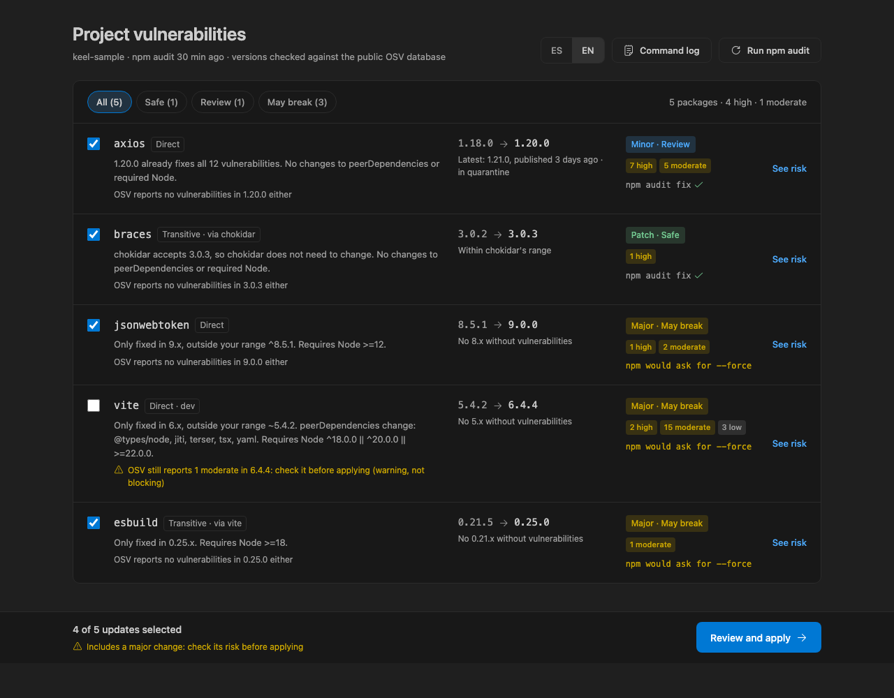
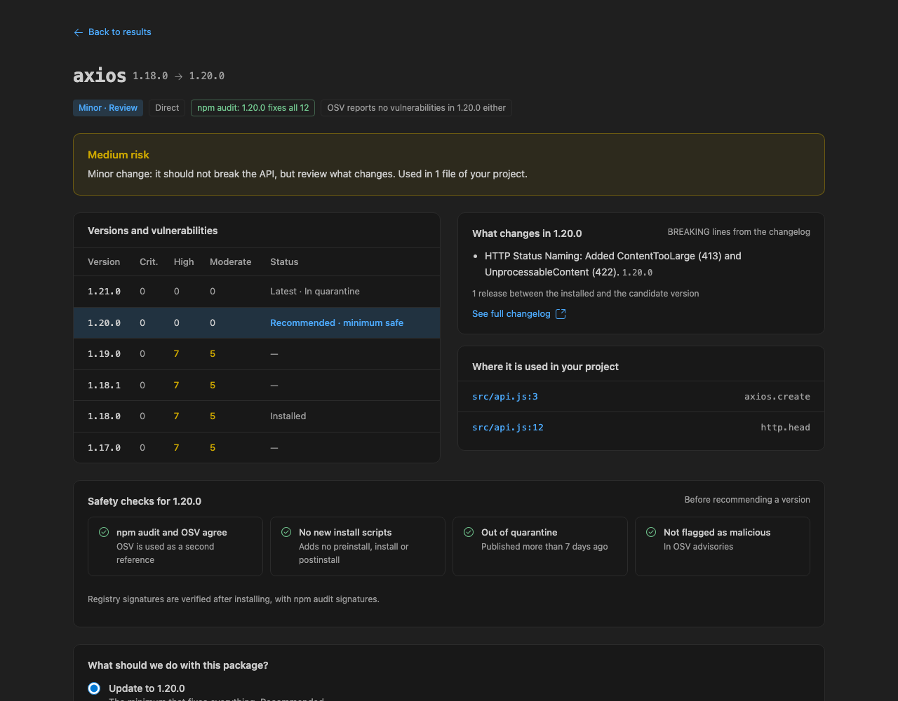
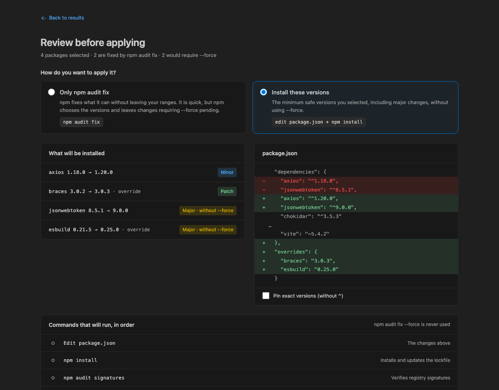

# Keel — Safe npm Fixes

*Fix npm vulnerabilities without breaking your project.*

A keel keeps a ship stable; Keel helps you make deliberate dependency upgrades instead of jumping straight to the newest release.

## CLI and agents

This repository ships `keel-npm` for the same safe scan, plan, approval, apply, revert, and report flow. It requires Node.js 20 or newer. The package is not published yet; once published, agents can use `npx keel-npm scan --json`, then plan selected packages and apply only the approved `planId`.

The plan ID binds the approved selection, choices, changes, manifest, and lockfile. Apply refuses stale plans, writes that plan to `package.json`, runs `npm install`, and never delegates changes to `npm audit fix`. Planned versions are pinned by default; `--keep-range` preserves the dependency range and allows npm to install a newer version within it. After install Keel checks the real lockfile versions: a pinned mismatch fails and offers revert, while a kept-range mismatch is reported as a warning. Reports always use installed lockfile versions. After success Keel rescans before reporting and deletes the snapshot. After failure it retains a snapshot, but revert refuses if `package.json` or `package-lock.json` changed in the meantime. Keel never uses `--force`. The generic agent workflow is in `skills/keel-fix-vulnerabilities/SKILL.md`.

### Verify an external vulnerability list

**Keel: Verify Vulnerability List** in VS Code and `keel-npm verify` answer "did I fix everything on this list?" for a report from another scanner. Put one entry per line: a CVE or GHSA code, a vulnerability title, or both (`CVE-2024-4068 Asymmetric denial of service`). Repeated lines are grouped.

```bash
keel-npm verify --file vulnerabilities.txt --lang es
pbpaste | keel-npm verify --file -
keel-npm verify CVE-2024-4068 GHSA-jr5f-v2jv-69x6 --json
```

- **Codes** are exact: Keel fetches the advisory from OSV (following a CVE to its GHSA alias), checks every installed copy of the affected package in `package-lock.json`, and cross-checks `npm audit`. Each one is *fixed*, *not installed*, or *still vulnerable* with the first fixed version.
- **Titles only** are approximate: Keel maps the type (XSS, ReDoS, path traversal, prototype pollution…) to CWEs and lists the advisories of that type that `npm audit` still reports. With none left, the entry is *likely resolved*. Unrecognized types, such as "Insecure functionality", are marked unverified.
- When a line has both, Keel also warns if the code does not look like the stated type.

The command reads the project and contacts `api.osv.dev` only; it changes nothing.

## The problem

`npm audit fix --force` can upgrade a dependency to its latest version, including a breaking major release. Meanwhile, `npm audit` identifies vulnerabilities but does not tell you the minimum version to upgrade to. Keel fills that gap by calculating and reviewing a safer candidate before anything changes.

## Features

- Runs `npm audit` and calculates the minimum non-vulnerable version.
- Keeps newly published versions in quarantine for a configurable number of days.
- Cross-checks candidates with OSV, or Snyk when configured, and rejects known malware advisories.
- Links each package to its public Snyk page so you can compare it yourself, with no token.
- Shows whether npm can apply a compatible fix and highlights patch, minor, and major upgrade risk.
- Provides package details, release-note impact, and text-based import references from your workspace.
- Lets you review the `package.json` diff and exact commands before approving either application method.
- Adds vulnerability diagnostics and recommended-version hovers to `package.json`.
- Supports English and Spanish.
- Discovers npm projects up to three folders deep and remembers the selected project folder.
- Offers reviewed removal of unused direct dependencies when scripts and root config files do not reference them.
- Produces a Markdown apply report and can create a deterministic branch and pull request after confirmation.







## How to use Keel

1. Open an npm project that contains a `package-lock.json`.
2. Run **Keel: Scan** from the Command Palette.
3. Review the candidates, risk information, and package details.
4. Select the changes you want, review the diff and commands, then explicitly approve the application method.
5. Optionally run the configured project tests and build after applying changes.

### Commands

- **Keel: Scan** — scan the current npm project and open the results.
- **Keel: Show Command Log** — show the commands Keel ran and their results.
- **Keel: Set Snyk Token** — store or clear the optional Snyk API token. Snyk's API generally requires an Enterprise plan; without a token, Keel uses OSV.
- **Keel: Select Project Folder** — choose among qualifying npm projects in the workspace.
- **Keel: Verify Vulnerability List** — check whether a list of CVE/GHSA codes or vulnerability titles from another scanner is fixed. Take the list from the clipboard, a file, or the active editor; the result opens as Markdown.

### Settings

- `keel.language` — webview and AI-summary language (`en` or `es`).
- `keel.quarantineDays` — minimum age, in days, for a release to be recommended.
- `keel.snykOrgId` — optional Snyk organization UUID used with the stored token (Snyk Enterprise).
- `keel.validationScripts` — project scripts to run after applying.
- `keel.pullRequestBaseBranch` — optional PR base branch; empty uses the repository default.

After applying, Keel can copy a report describing updated or removed packages, remaining issues, validation results, and registry warnings. Successful applies can create a `keel/fix-…` branch and PR. This refuses unrelated working-tree changes and never overwrites or force-pushes a branch.

## Privacy and network

Keel does not collect telemetry. It only makes requests to `registry.npmjs.org`, `api.osv.dev`, `api.snyk.io`, and `api.github.com`. The optional Snyk token is stored in VS Code SecretStorage.

AI-generated release-note summaries are optional and use the VS Code language model provided by Copilot. When used, the relevant release notes are sent to that model.

## Safety

Keel never uses `--force` and applies nothing without explicit approval. After applying, it can run the application-scoped `keel.validationScripts` that exist in `package.json` (by default `test` and `build`) with `CI=true`; project scripts require a trusted workspace. It also checks lockfile download hosts against npm and project registry configuration, and offers an explicit in-memory rollback after a failed mutating, registry, or validation step.

## Limitations

- Keel supports npm only.
- Monorepos that declare `workspaces` are not supported.
- An `overrides` entry can force a version outside the range requested by a parent package. Test your build after applying changes.
- Changelog information depends on GitHub Releases being available for the package repository.
- Import detection is text-based rather than a full syntax-tree analysis.

## License

[MIT](LICENSE) © 2026 HenryD5.
